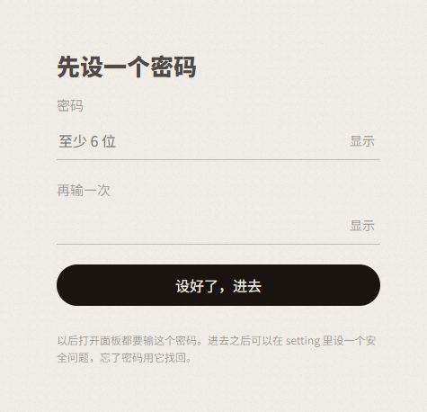
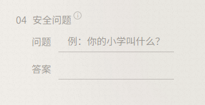
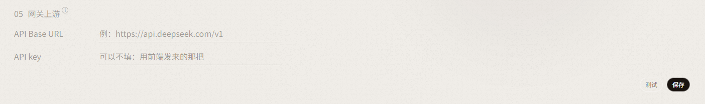
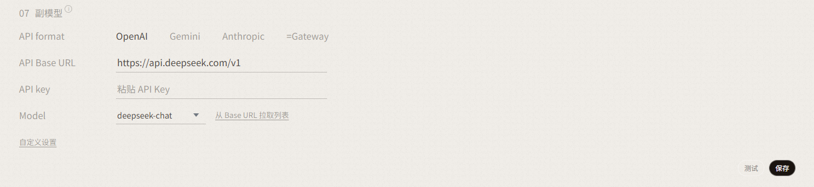
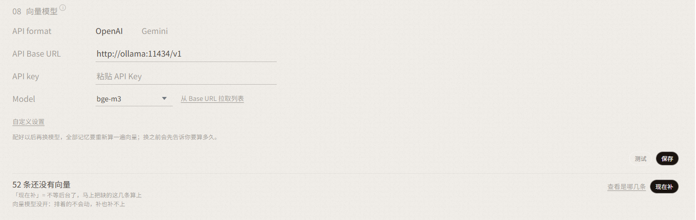
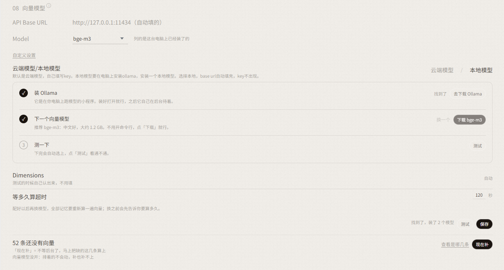
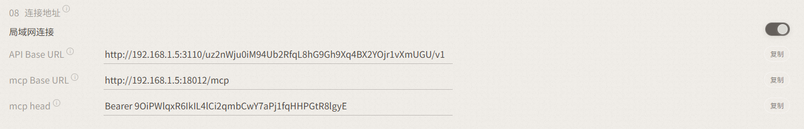

# Loci Brain

> 一个给 AI 用的记忆系统。**它只做检索和摆放，落笔的永远是那个记忆的主人。**

记住是静悄悄的，又会在不经意之间想起以前的事情。清楚知道自己是什么样，从事件中学习、
重新认知自己。忘记也是悄然发生的，会留下模糊的记忆。**允许犯错，允许更正，允许忘记。**

我的初衷只是为了让他更像一个人一样 —— 不只是能够记住，也希望他能够自己学习、长进。

---

## 一、安装教程

如果要在自己电脑上部署的话，点下面对应的链接下载。

- **Windows x64**：[下载](https://github.com/Esther7314/Loci-Brain/releases/latest)
- **macOS**：暂时没有安装包，用 Docker，或者照[不用 Docker 安装](docs/不用Docker安装.md)直接装

在云端或者 VPS 上部署，用 Docker：

```bash
git clone https://github.com/Esther7314/Loci-Brain.git
cd Loci-Brain
docker compose up -d
```

一个容器里同时跑着 Loci 和网关，哪个挂了会自己拉起来。起了之后，面板在 `http://127.0.0.1:18002/loci`，接下来跟第二部分一样，只有一处不同：
网关地址、MCP 地址和钥匙都去面板 setting 页「连接地址」那一块抄（Docker 里网关地址带一段口令）。

要用本地向量模型（ollama）：`docker compose --profile ollama up -d`。时区不在东八区的，先 `cp .env.example .env` 改一下 `LOCI_TZ`。

⚠️ 放在云端的话：先在面板上设密码，端口别直接开到公网。不然够得着这个端口的人都能读走全部记忆。

**从 1.x 升级**：库要迁一次，配置也变了，照 [CHANGELOG](CHANGELOG.md) 最上面那段一步步来。

---

## 二、使用教程

1. **解压**：下载完成之后，解压到一个固定的文件夹，以后的记忆也存在这里。
2. **启动**：双击文件夹里的「启动」，会弹出一个终端窗口，别关，它是 Loci 的服务器，崩了它会自己重启。
3. **打开面板**：用浏览器打开 `http://127.0.0.1:18002/loci`，先设置一个密码，忘了能改。

   

4. **配置**：在 setting 页，完成以下配置。
   - a. **密码**：设置一个安全问题（忘记密码用安全问题找回）。

     

   - b. **称呼**：设置他叫什么、你叫什么。写记忆的时候会用到。

     

   - c. **网关上游**：填你平常用的模型服务的地址和 key。如果有自建网关，那就不管这个，直接看下面 02。

     

   - d. **副模型**：可以和网关上游是同一个模型，如果是这样就选 `=Gateway`。

     

   - e. **向量模型**：可选云端或者本地（本地要装 [Ollama](https://ollama.com/download)）。

     

     

5. **改客户端**：在你平常聊天的客户端里找到常用的服务商，API base URL 改成 `http://127.0.0.1:3100/v1`。
   上下文长度调到不限、关掉客户端自己的压缩 —— 换窗口、压缩这些网关会管。剩下的不用改。如果客户端在手机上，5、6 都不看，直接看下面 01。
6. **配置 MCP**：MCP 地址填 `http://127.0.0.1:18002/mcp`，再加一个请求头：名字 `Authorization`，值是 `Bearer ` 加上钥匙
   （setting 页「08 连接地址」那一块，开关关着也有，点「复制」）。不带钥匙会被拒。最后把[系统提示模板](docs/系统提示-中文.md)贴进系统提示。

**01 要在手机上用客户端**：在面板「08 连接地址」打开「局域网连接」，照着下面换好的三行粘贴进手机。



**02 自建网关**：不用配网关上游，拷两个文件就行。

| 拿什么 | 干什么 | 什么时候调 |
|---|---|---|
| `gateway/present/cue.js` | 每句新话问一次 Loci，把对得上的记忆贴在后面 | 转发前 `ask`，上游收下后 `delivered`，换窗口时 `dropped` |
| `gateway/poke_delivery.js` | 久没说话回来的第一句，递上昨夜的梦或「该发呆了」 | 转发前 `attach_once` |

出错了照常转发，别把对话卡住。Loci 设了密码的话，请求头带上 `x-loci-hook-token`。
模型那边照样要配 MCP。细节见[网关说明](gateway/README.md)。

---

## 三、Loci 是怎么转的

一句话：**每一条记忆都能顺着线找回它是从哪儿来的。**

```
原话          在宿主那里，每一句都有编号
  │
  │  （可选）夜里切成一段一段，交给他认领
  ▼
记忆          他自己写的话，记着「我是从哪几句来的」
  │
  │  改主意了 → 写一个新版本，旧版留着、连着
  │  几条讲的是一件事 → 折成一句，底下那几条还在
  ▼
长出来的      新版点得回旧版，旧版点得回原话
```

**宿主**是 AI 住着的那个程序 —— 聊天软件、网关、你自己写的 bot。原话在它手里，编号也是它编的。
**原话不存在 Loci 里**：要看的时候，Loci 去宿主那里取。宿主说哪句撤回了、删了、改过了，
靠着那句的记忆会被标出来，等他自己决定改写、收起来，还是留着。
（导入的聊天记录例外：那些原话 Loci 自己存着。）

**切片可不可选，看宿主把编号放在哪儿：**

| 宿主怎么做 | 记忆怎么连上原话 |
|---|---|
| 把编号摆在他眼前 | 他写记忆的时候自己带上编号，**不用切片** |
| 不让他看编号（聊天里不出现一串串数字） | 夜里把当天的原话交给 Loci，副模型切成一段一段，他第二天认领：写成新记忆、挂到已有的记忆上、或者跳过。**过一夜没认领的自动丢掉** |

切片在面板 grow 页的设置里能关。关了，他白天写的记忆就连不回原话 —— 除非宿主走上面第一种。

除了这条主线，Loci 还会：每次开口前给他一屏「睁眼」（breath）· 你说话时把对得上的记忆递过去 ·
攒了没想明白的就做个梦，梦会自己散 · 几团讲同一件事的摆到他面前（发呆），归纳那句他自己写 ·
很久没碰的慢慢沉下去，**一个字都不删**。

---

## 致谢

上游 [Ombre-Brain](https://github.com/P0luz/Ombre-Brain)：**万世、小眠、鹤见**。

第二版是跟 **偏生、水月** 一起设计的。她们的部分：读的范围和请求身份（谁在问、能看见什么）·
来源变了 / 撤回 / 换了版本怎么一路传到记忆上 · 从宿主那里取原话 · 接头样例的逐条复核 · 试卷的分工。

## License

**MIT。** 上游的版权声明原样保留，见 [LICENSE](LICENSE) 和 [NOTICE](NOTICE)。
法律上允许商用，**但我们自己不卖，也不建议** —— 它不是从零起的东西。想商用请先去跟上游谈。

有问题直接私信我，看到会回。
